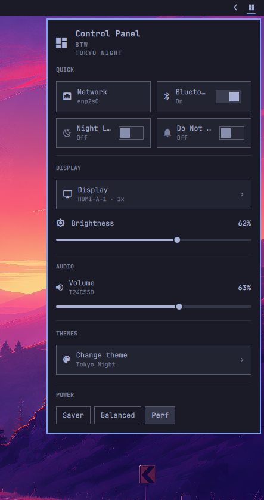

# Control Panel (`oma.controlpanel`)

A **control center** for the Omarchy bar: a popup anchored
to its bar button with a grid of quick toggles and sliders, so the things you
reach for most often are one click away instead of spread across the individual
audio / network / bluetooth / power panels.

<p align="center">
  
</p>

## Install

Add the plugin from the repository and enable it in the bar:

```bash
omarchy plugin add https://github.com/archlatam/oma.controlcenter.git --enable
```

## Update

```bash
omarchy plugin update oma.controlpanel
```

## Remove

```bash
omarchy plugin remove oma.controlpanel
```

## What's in the panel

| Section | Control |
|---------|---------|
| Quick | **Network** — connected network, Wi-Fi radio toggle when a Wi-Fi card is present; click the tile body to open the [Network detail page](#network-detail-page) |
| Quick | **Bluetooth** — adapter on/off, connected-device count; click the tile body to open the [Bluetooth detail page](#bluetooth-detail-page) |
| Quick | **Night Light** — on/off |
| Quick | **Do Not Disturb** — on/off |
| Audio | Output volume slider + right-click to mute |
| Display | Brightness slider; click the **Display** row to open the [Display detail page](#display-detail-page) |
| Themes | Click the **Change theme** row to open the [Themes page](#themes-page) |
| Power | Battery level/state + AC/Battery power profile (when available) |

The panel refreshes its polled state (connection name, brightness, night light,
DND, power profile) when it opens and every 4 seconds while it is open. Live
state (Wi-Fi enabled, Bluetooth, audio volume, battery) comes straight from
Quickshell services and needs no polling.

### Network detail page

Clicking the body of the **Network** tile (the switch, when present, still
toggles Wi-Fi) opens a detail page inside the same popup, with a back button or
`Esc` to return:

| Row | Source |
|-----|--------|
| Connection | `omarchy-network-status` |
| IP address + gateway | `omarchy-network-status --verbose` |
| Latency | `internet_ping_ms` |
| Link speed | negotiated link rate |
| **Wi-Fi networks** | live scan from Quickshell's `Networking` service |
| **DNS provider** | `omarchy-dns` (DHCP / Cloudflare / Google / Custom) |
| **Speed test** | `omarchy-network-speedtest down\|up` |

The **DNS provider** row is a group of pills that mirrors the built-in
`omarchy.network` panel. Selecting one rewrites the system resolver through
`omarchy-dns` (it uses the passwordless `omarchy-dns` sudoers rule, or polkit as
a fallback); **Custom** opens a floating terminal to type the servers.

The **Run speed test** button measures download for a few seconds, then upload,
showing live Mbps (the same engine the built-in `omarchy.speedtest` uses). It
runs on demand and stops automatically when you leave the page or close the
panel, so it never saturates the link in the background.

#### Wi-Fi networks

On a machine with a Wi-Fi card the connection details are followed by the
nearby networks:

- Click a network to connect. A **protected network with no saved credentials**
  expands an inline field underneath the row for the passphrase; **WPA-Enterprise**
  networks also ask for an identity. Enter (or the check button) connects, `Esc`
  cancels.
- A wrong passphrase shows **Wrong password** and reopens the field so it can be
  re-entered.
- Left-click a connected network to **disconnect** it.
- Right-click (or press-and-hold) a saved but disconnected network to **forget**
  it.
- Scanning starts when the page opens and stops when you leave it or close the
  panel, so the radio is not held scanning in the background.

This mirrors the built-in `omarchy.network` panel: rows are primitive snapshots
and the live network is resolved by SSID when you act, so NetworkManager churn
(scans, AP removals) can't crash the shell.

### Bluetooth detail page

Clicking the body of the **Bluetooth** tile (the switch, when present, still
toggles the adapter) opens its detail page, with a back button or `Esc` to
return:

- An **adapter** row: icon, on/off state and the same switch as the tile.
- **Connected** devices: click a row to disconnect.
- **Paired** devices: click a row to connect.
- **Available** devices (discovered while the page is open): click to pair.
- Battery percentage is shown for connected devices that report one.

Left-click acts on a device; **right-click forgets** a connected or paired one.
Only devices with a real name are listed — BlueZ often exposes entries whose
name is just a UUID or the raw address, and those are hidden. Scanning starts
when the page opens and stops when you leave it or close the panel, so the
radio is not held scanning in the background. Actions go through
`omarchy-bluetooth-device`, matching the built-in Bluetooth panel.

### Display detail page

Clicking the **Display** row under the DISPLAY section opens a detail page with
a back button or `Esc` to return:

| Control | Source |
|---------|--------|
| Brightness | `omarchy-brightness-display`; hidden when there is no controllable backlight |
| Text size | `omarchy-display-text-size`; snaps to the 9–20 px stops |
| Scale | `omarchy-hyprland-monitor-scaling`; 1x … 4x, filtered to the scales the focused monitor supports |
| Displays | `hyprctl` (`hl.monitor`); enable/disable each output, shown only with more than one monitor |

The Displays list never lets you disable the last enabled output.

The built-in `omarchy.monitor` panel toggles monitors with `hyprctl keyword
monitor`, which Hyprland 0.56's new parser rejects; this page uses `hyprctl eval
"hl.monitor(...)"` instead, the same call Omarchy's own scaling helper uses.

### Themes page

Clicking the **Change theme** row under the THEMES section opens a page with a
back button or `Esc` to return:

| Control | Source |
|---------|--------|
| Preview | the highlighted theme's `preview.png` (or its first background) |
| Installed list | theme directories under `~/.config/omarchy/themes` and `$OMARCHY_PATH/themes`, with a thumbnail per theme |
| **Set theme** | `omarchy-theme-set` |

Selecting a theme highlights it and shows its preview; the switch is only
committed from the **Set theme** button, because applying a theme runs Omarchy's
theme hooks and repaints the whole desktop. The current theme is marked with a
check, and the button reads **Current theme** when the highlighted theme is
already active.

## Dependencies

Only standard Omarchy tooling, all present on a stock install:

- `omarchy-network-status`
- `omarchy-network-speedtest` (for the Network detail page's speed test)
- `omarchy-dns` (Network detail page: provider pills)
- NetworkManager via Quickshell's `Networking` service (Wi-Fi networks list and connect)
- `nmcli` and `uuidgen` (Wi-Fi networks: 802.1X / WPA-Enterprise profiles)
- `omarchy-bluetooth-power`
- `omarchy-bluetooth-device` (connect / disconnect / pair / forget)
- `omarchy-monitor-state` (Display detail page: focused monitor, scale, outputs)
- `omarchy-display-text-size` (text size)
- `omarchy-hyprland-monitor-scaling` (monitor scale)
- `hyprctl` (`eval hl.monitor`) (enable / disable outputs)
- `omarchy-theme-current` (active theme name)
- `omarchy-theme-set` (Themes page: switch theme)
- `omarchy-toggle-nightlight`
- `omarchy-brightness-display`
- `omarchy-shell notifications` (DND state / toggle)
- `powerprofilesctl` (optional; the Power section hides the profile picker if absent)

Plus Quickshell services: `Networking`, `Bluetooth`, `Services.Pipewire`,
`Services.UPower`.

## Notes

- **Wi-Fi toggle** only appears when a Wi-Fi device exists. On wired-only
  machines the Network tile shows the connection and hides the switch.
- **Brightness** reads and writes through `omarchy brightness display`, so it
  follows the focused display exactly like the brightness keys do.
- **Battery / power profile** rows appear only when the hardware reports a
  battery and `powerprofilesctl` answers.

## License

MIT — see [LICENSE](LICENSE).
